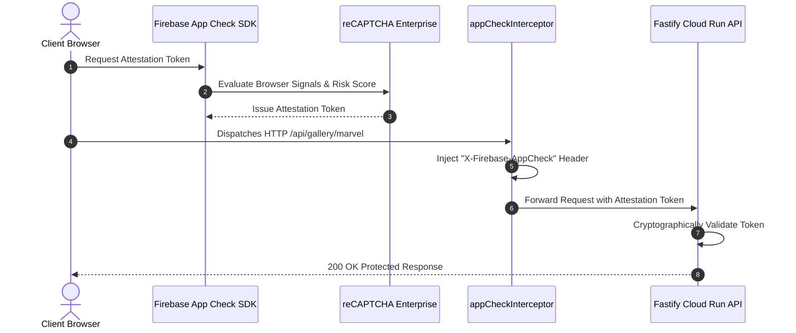
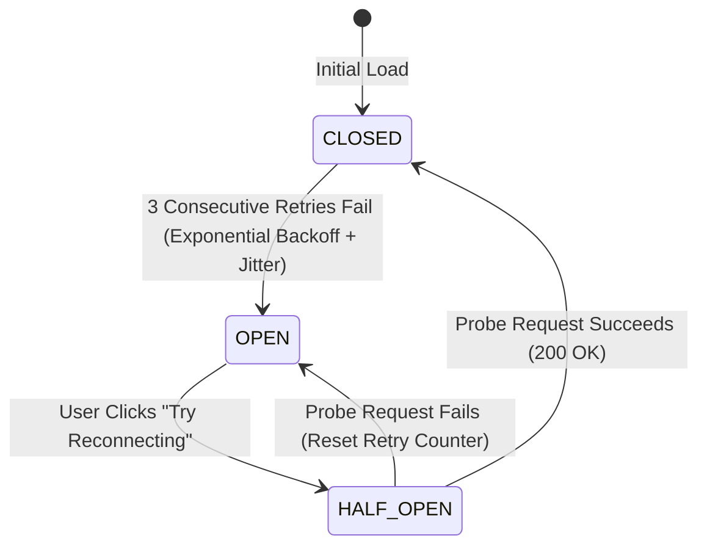
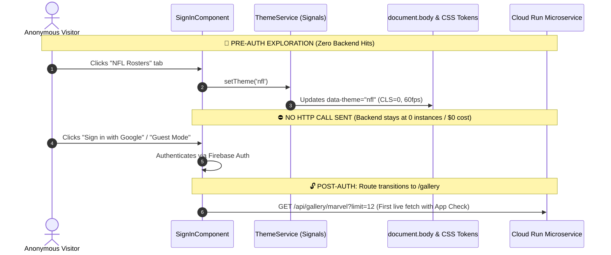

# 🎨 Meraki Generic Gallery

[](https://angular.dev/)
[](https://www.typescriptlang.org/)
[-6E9F18?logo=vitest&logoColor=white>)](https://vitest.dev/)
[](https://firebase.google.com/docs/app-check)
[](https://firebase.google.com/docs/analytics)
[](https://playwright.dev/)
[](https://firebase.google.com/)
[](https://nodejs.org/)
[](https://www.conventionalcommits.org/)

An enterprise-grade, high-performance web application engineered with **Angular 22 Zoneless**, **Signals Reactive State**, **Firebase App Check (reCAPTCHA Enterprise Attestation)**, **Google Analytics 4 Telemetry & Funnel Tracking**, **Hardware-Accelerated Dynamic Theming**, **Client-Side Circuit Breaker Network Resilience**, **Intelligent Cold-Start & Egress Optimization**, and **Shift-Left Two-Tier Quality Testing (Vitest + Playwright)**, deployed to **Firebase Hosting** using **Keyless Workload Identity Federation (WIF)**.

---

## 🌟 Modern Architectural Highlights

### 1. 🔐 Cryptographic Client Attestation (Firebase App Check & reCAPTCHA Enterprise)

To shield the backend microservice from unauthorized traffic, automated scrapers, and bot abuse, the client implements **Firebase App Check** powered by **Google Cloud reCAPTCHA Enterprise**:

- **Invisible Risk Scoring**: In production, the client browser initializes `ReCaptchaEnterpriseProvider` with automatic background token refreshes (`isTokenAutoRefreshEnabled: true`), evaluating browser integrity signals invisibly without intrusive user challenges.
- **Selective HTTP Interceptor Attestation**: The Angular HTTP client utilizes a functional interceptor (`appCheckInterceptor`) that seamlessly fetches valid attestation tokens via `getToken(appCheck, false)` and attaches the `X-Firebase-AppCheck` header to outbound requests.
- **Zero Token Leakage Guarantee**: Outbound requests are strictly inspected to ensure attestation tokens are **only dispatched to protected backend APIs** (`/api/`, `environment.API_URL`, `/gallery/`), explicitly preventing token exposure to external CDN endpoints (`espncdn.com`, `jsdelivr.net`, `googleapis.com`).
- **Frictionless Local Development**: Configured with a `CustomProvider` debug mock on localhost, allowing developers to execute unit tests and run local dev servers without needing live reCAPTCHA credentials or encountering blocked requests.



### 2. 📊 User Telemetry & Funnel Analytics (Google Analytics 4 & Firebase)

The application incorporates a structured, privacy-conscious event telemetry layer via `AnalyticsService`, integrated with Firebase Analytics (GA4):

- **Event Taxonomy & Funnels**: Captures critical user journeys, content discovery, and gameplay progression without tracking personal identifying information (PII):

| Event Name               | Parameters                                             | Purpose & Funnel Metric                                                            |
| :----------------------- | :----------------------------------------------------- | :--------------------------------------------------------------------------------- |
| `theme_changed`          | `selected_theme`, `source`                             | Analyzes user brand preference (Marvel vs. NFL) and tab interaction entrypoints    |
| `search_gallery`         | `search_term`, `category`                              | Surfaces search demand patterns, user discovery intent, and character catalog gaps |
| `trivia_started`         | `category`                                             | Tracks gameplay conversion and engagement rate from gallery browsing               |
| `trivia_guess_submitted` | `character_name`, `is_correct`, `category`, `attempts` | Measures character difficulty curves, hint effectiveness, and accuracy rates       |
| `trivia_skipped`         | `character_name`, `category`                           | Flags overly ambiguous or obscure character cards needing better clues             |
| `trivia_completed`       | `final_score`, `total_questions`                       | Measures user retention, session length, and completion rates                      |
| `login` / `logout`       | `method` (`google` vs. `guest`)                        | Monitors authentication conversion and developer guest mode usage                  |

- **Automated Route & Visitor Telemetry**: Utilizes Angular Fire's `ScreenTrackingService` to automatically record route transitions across `/login` and `/gallery`, and `UserTrackingService` to track authenticated session lifecycles.
- **Environment & Privacy Gating**: Telemetry is gated by `shouldLog()`, executing strictly in production when `environment.analytics.enabled` is `true`, preventing local development or test runs from polluting analytics datasets.

### 3. ⚡ 100% Zoneless Change Detection (`provideZonelessChangeDetection`)

- Completely eliminates **Zone.js** runtime monkey-patching, reducing initial JavaScript payload weight and eliminating microtask scheduler overhead.
- Change detection cycles are dispatched purely on-demand via Angular **Signals** and native browser DOM events, maximizing frame rates and guaranteeing predictable UI rendering.

### 4. 📡 Signals-First Reactive State Management & Signal Forms

- **Encapsulated Reactive Store**: Internal state is held in private writable signals (`#images`, `#selectedCategory`, `#currentChallenge`) and exposed cleanly via public readonly signals (`imagesSignal`, `selectedCategorySignal`, `currentChallengeSignal`).
- **Declarative Signal Forms**: Mystery card guessing in Play Mode utilizes `@angular/forms/signals` (`form()`, `required()`) for reactive schema validation, eliminating legacy `FormGroup` boilerplate and offering instant typed validation states.
- **Pure Derived Computations**: UI states (`isOffline`, `isReconnecting`, `currentCard`, `filteredCards`) are derived via `computed()`, re-evaluating only when their specific signal dependencies change.
- **Automated DOM Synchronization**: Root `effect()` listener in `ThemeService` synchronizes active theme changes into `document.body` and CSS custom properties with zero manual subscription management.

### 5. 🔄 Self-Healing Circuit Breaker & Exponential Backoff

The communication layer (`ImagesFromServerService`) incorporates an automated client-side **Circuit Breaker** with **Exponential Backoff**:

- **`CLOSED` State**: Normal operation. Automatically executes up to **3 retries** with exponential delay ($1\text{s} \to 2\text{s} \to 4\text{s}$ with random jitter) when encountering transient network hiccups or backend cold-start delays.
- **`OPEN` State**: Tripped after consecutive retries fail. Prevents network flooding and renders the high-polish, branded **"Gallery Service Connecting"** offline card with **zero internal URLs or hostnames exposed**.
- **`HALF_OPEN` State**: Initiated when the user clicks **"Try Reconnecting"**. Executes a single probe request with live spinner feedback, immediately resuming live gallery rendering once the backend microservice awakens.



### 6. 🎯 Intelligent Edge Hydration & Zero Pre-Auth Cold-Start Optimization

- On the unauthenticated landing and sign-in page, visitors can freely explore **Marvel Multiverse**, **NFL Rosters**, and **Trivia Challenge** previews.
- **Pure Local State Decoupling**: Tab switching is driven entirely by `ThemeService` signals and static asset caches, **triggering zero HTTP network calls to the backend microservice**.
- Eliminates premature Cloud Run container cold starts, avoids unwanted network egress, and delivers instant, sub-millisecond theme transitions before authentication.



### 7. 🚀 Hardware-Accelerated Dynamic Theme Engine

- Dual-layer preloaded wallpaper architecture (`.bg-marvel` and `.bg-nfl`) composited via GPU-accelerated CSS `opacity` transitions (`will-change: opacity; transition: opacity 0.6s cubic-bezier(0.4, 0, 0.2, 1);`).
- Guarantees **60fps, zero flicker, and zero cumulative layout shifts (CLS = 0)** when toggling between themes.
- Cohesive design tokens transition headers, category filter pills, search focus glows, card elevations, and action buttons dynamically.

---

## 📁 Repository Structure & Scaffold

```text
prj-generic-gallery/
├── .husky/
│   ├── pre-commit                  # Shift-left quality gate (lint-staged + typecheck + vitest)
│   └── commit-msg                  # Conventional commit message validation
├── src/
│   ├── app/
│   │   ├── core/
│   │   │   ├── interceptors/       # App Check attestation token injector (appCheckInterceptor)
│   │   │   ├── services/           # AnalyticsService (GA4 event taxonomy & funnels)
│   │   │   ├── auth.service.ts     # Firebase Auth (Google Sign-In & Guest Mode)
│   │   │   ├── images-from-server.service.ts # Circuit breaker, signals & REST client
│   │   │   ├── loader.service.ts   # Global loading state coordinator
│   │   │   └── theme.service.ts    # Dynamic Marvel/NFL theme engine
│   │   ├── gallery/
│   │   │   ├── card-item/          # Decomposed presentational card component
│   │   │   ├── gallery.component.ts# Main gallery collection & infinite scroll
│   │   │   └── gallery.component.html # Search, category pills, & mode toggle
│   │   ├── game-mode/
│   │   │   ├── game-mode.component.ts # Encapsulated Trivia Game (Signal Forms)
│   │   │   └── game-mode.component.html # Mystery card, clues, & confetti cues
│   │   ├── sign-in/                # Landing page & zero pre-auth showcase
│   │   ├── toolbar/user-menu/      # User profile menu & theme switcher
│   │   ├── loader/                 # Animated infinity SVG loader
│   │   ├── app.config.ts           # Zoneless providers, Analytics & App Check
│   │   └── app.routes.ts           # Authentication route guards
│   ├── environments/
│   │   ├── environment.ts          # Local dev environment (port 3000, dev key, custom App Check)
│   │   └── environment.prod.ts     # Production environment (CI/CD injected secrets & reCAPTCHA)
│   ├── styles.scss                 # Theme design tokens & CSS custom properties
│   └── main.ts                     # Application bootstrap with zoneless detection
├── tests/
│   └── visual/                     # Playwright visual regression snapshots
├── scripts/
│   └── inject-env.mjs              # CI/CD secret injector for production builds
├── angular.json                    # Modern @angular/build Vite/esbuild configuration
└── vitest.config.ts                # Fast zoneless unit test configuration
```

---

## 📸 Interactive Features & Visual UI Showcase

### 🦸 Marvel Heroes Collection Theme

Features the dynamic Marvel Crimson Red (`#E23636`) palette, responsive category pills, character cards, and live search.


### 🏈 NFL Players Collection Theme

Transitions instantly to the Official NFL Royal Navy (`#013369`) and Stadium Cyan (`#4FA3E3`) branding with NFL Shield iconography.


### 🔍 Ergonomic Live Search

Instant debounced search filtering with clear action and dynamic focus glow matching active theme tokens.


### 🎮 Interactive Trivia Guessing Game Mode (Play Mode)

Mystery card presentation with obscured character identity, clue reveals, signal-driven form validation, confetti particle explosion on correct guesses, and visual shake animations on incorrect guesses.


### 🔐 Authentication & Guest Mode

Secure authentication supporting Google Sign-in and instant Demo Guest Mode.


---

## 🧪 Two-Tier Testing Architecture

```
                                  Testing Strategy
                                         │
        ┌────────────────────────────────┴────────────────────────────────┐
        ▼                                                                 ▼
Tier 1: Unit & Signals Suite                               Tier 2: Visual Regression Suite
• Vitest 5.1 + JSDOM 31                                    • Playwright 1.65 (Headless Chromium)
• provideZonelessChangeDetection()                         • Desktop Chrome (1280x800)
• 47 tests across 9 suites in <1.2s                        • Mobile Chrome (390x844)
• Tests services, signals, effects, App Check & circuit breaker • 16 platform-independent pixel baselines
```

### Running Tests Locally

```bash
# Tier 1: Fast Zoneless Unit Tests (Vitest - 47 tests in <1.2s)
npm run test:unit

# Tier 1: Watch mode
npm run test:unit:watch

# Tier 2: Visual Regression Tests (Playwright)
npm run test:visual

# Update visual baseline snapshots
npm run test:visual:update

# Interactive Playwright UI Mode
npm run test:visual:ui
```

---

## 🔒 Shift-Left Pre-Commit Architecture & CI/CD Quality Gates

Quality is enforced at the earliest possible stage: **on the developer's workstation before code ever leaves the machine**.

### 1. Shift-Left Local Quality Gate (`.husky/pre-commit`)

Whenever `git commit` is executed, Husky runs a three-tier local validation:

1. **`lint-staged`**: Enforces ESLint (`0 errors, 0 warnings`) and Prettier code formatting on staged files.
2. **`npm run typecheck`**: Runs `tsc --project tsconfig.app.json --noEmit` to verify type safety across the entire application.
3. **`npm run test:unit`**: Executes the complete Vitest zoneless suite (47 tests across 9 test suites in ~1.1s).

If any linter issue, type discrepancy, or unit test fails, the commit is blocked locally with an actionable error.

```mermaid
flowchart LR
    DEV["Developer Workstation"] --> HUSKY["Git Pre-Commit Hook (.husky)"]
    HUSKY --> LINT["lint-staged (ESLint + Prettier)"]
    LINT --> TC["typecheck (tsc --noEmit)"]
    TC --> VITEST["test:unit (Vitest 47/47 in 1.1s)"]
    VITEST --> PUSH["Git Push to GitHub"]
    PUSH --> CI["GitHub Actions CI"]
    CI --> BUILD["Production Build (@angular/build)"]
    BUILD --> VISUAL["Playwright Visual Baselines (16/16)"]
    VISUAL --> DEPLOY["Firebase Hosting (Keyless WIF)"]
```



### 2. CI/CD Pipeline & Keyless Cloud Deployment

Every pull request and merge to `develop` and `main` is gated by strict automated checks in GitHub Actions:

- **Keyless Google Cloud Authentication**: Deploys via **Workload Identity Federation (WIF)**. No service account keys (`.json`) are stored in GitHub secrets; GitHub Actions exchanges short-lived OIDC tokens directly with Google Cloud IAM.
- **Fail-Fast Hard Gate**: Continuous Deployment **never** triggers if any linting, unit test, build, or visual regression check fails.

---

## 🛠️ Local Development & Scripts

### Prerequisites

- **Node.js**: `v24.x` or `v26.x LTS`
- **npm**: `v10.x` or higher

```bash
# Clone the repository
git clone https://github.com/himanshusaraswat/prj-generic-gallery.git
cd prj-generic-gallery

# Install dependencies & initialize git hooks
npm ci

# Start local Angular development server (port 4200)
npm start

# Run full linting, format check & typecheck
npm run lint
npm run format:check
npm run typecheck

# Execute fast unit tests
npm run test:unit

# Production build
npm run build-prod
```

---

## 📄 License

MIT © [Himanshu Saraswat](https://github.com/himanshusaraswat)
