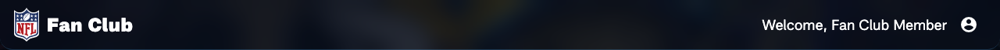
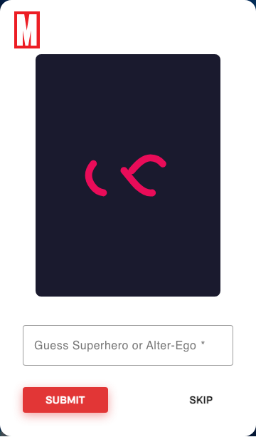
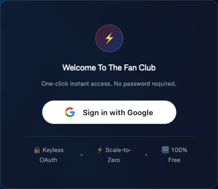
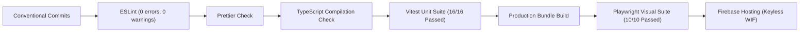

# 🎨 Meraki Generic Gallery

[](https://angular.dev/)
[](https://www.typescriptlang.org/)
[](https://vitest.dev/)
[](https://playwright.dev/)
[](https://firebase.google.com/)
[](https://nodejs.org/)
[](https://www.conventionalcommits.org/)

An enterprise-grade, high-performance web application built with **Angular 22 Zoneless**, **Signals**, **Hardware-Accelerated Theming**, **Circuit Breaker Network Resilience**, and **Playwright Visual Regression Testing**, deployed to **Firebase Hosting** using **Keyless Workload Identity Federation (WIF)**.

---

## 🌟 Modern Architectural Highlights

### 1. ⚡ 100% Zoneless Change Detection (`provideZonelessChangeDetection`)

- Completely eliminates **Zone.js** runtime monkey-patching, reducing initial bundle weight and eliminating microtask scheduler contention.
- Change detection cycles are triggered purely on-demand via Angular **Signals** and native browser events, ensuring maximum rendering throughput and predictable execution.

### 2. 📡 Signals-First Reactive State

- **State Encapsulation**: Private writable signals exposed as public readonly signals (`selectedCategorySignal`, `imagesSignal`, `searchQuerySignal`, `currentChallengeSignal`).
- **Derived Computations**: `computed()` derivations for reactive UI logic (`isOffline`, `isReconnecting`).
- **DOM & Theme Synchronization**: Root `effect()` listener in `ThemeService` synchronizes active category selections directly into `document.body` and CSS custom properties with zero manual subscriptions.

### 3. 🛡️ Circuit Breaker & Exponential Backoff Pattern

The service communication layer (`ImagesFromServerService`) incorporates a self-healing client-side **Circuit Breaker** with **Exponential Backoff**:

- **`CLOSED` State**: Standard operational state. Automatically attempts up to **3 retries** with exponential delay ($1\text{s} \to 2\text{s} \to 4\text{s}$ with jitter) during transient network failures.
- **`OPEN` State**: Tripped after consecutive retry failures. Prevents network spam and renders the high-polish, branded **"Gallery Service Connecting"** offline card with **zero internal URLs or hostnames exposed**.
- **`HALF_OPEN` State**: Initiated when the user clicks **"Try Reconnecting"**. Executes a single probe request with live spinner feedback, immediately resuming live gallery rendering once the backend awakens.

### 4. 🚀 Hardware-Accelerated Dynamic Theme Engine

- Dual-layer preloaded wallpaper architecture (`.bg-marvel` and `.bg-nfl`) composited via GPU-accelerated CSS `opacity` transitions (`will-change: opacity; transition: opacity 0.6s cubic-bezier(0.4, 0, 0.2, 1);`).
- Guarantees **60fps, zero flicker, and zero cumulative layout shifts (CLS = 0)** when toggling between themes.
- Cohesive design tokens transition headers, category filter pills, search focus glows, card elevations, and action buttons dynamically.

---

## 📸 Interactive Features & Visual UI Showcase

### 🦸 Marvel Heroes Collection Theme

Features the dynamic Marvel Crimson Red (`#E23636`) palette, responsive category pills, character cards, and live search.


### 🏈 NFL Players Collection Theme

Transitions instantly to the Official NFL Royal Navy (`#013369`) and Stadium Cyan (`#4FA3E3`) branding with NFL Shield iconography.



### 🔍 Ergonomic Live Search

Instant debounced search filtering with clear action and dynamic focus glow matching active theme tokens.


### 🎮 Interactive Trivia Guessing Game Mode (Play Mode)

Mystery card presentation with obscured character identity, clue reveals, signal-driven form validation, confetti particle explosion on correct guesses, and visual shake animations on incorrect guesses.



### 🔐 Authentication & Guest Mode

Secure authentication supporting Google Sign-in and instant Demo Guest Mode.



---

## 🧪 Two-Tier Testing Architecture

```
                                  Testing Strategy
                                         │
        ┌────────────────────────────────┴────────────────────────────────┐
        ▼                                                                 ▼
Tier 1: Unit & Signals Suite                               Tier 2: Visual Regression Suite
• Vitest 5.1 + JSDOM 31                                    • Playwright 1.65 (Headless Chromium)
• provideZonelessChangeDetection()                         • Desktop Chrome (1280x800)
• 16 tests across 4 suites in <600ms                       • Mobile Chrome (390x844)
• Tests services, signals, effects & circuit breaker       • 16 platform-independent pixel baselines
```

### Running Tests Locally

```bash
# Tier 1: Fast Zoneless Unit Tests (Vitest)
npm run test:unit

# Tier 1: Watch mode
npm run test:unit:watch

# Tier 2: Visual Regression Tests (Playwright)
npm run test:visual

# Update visual baseline snapshots
npm run test:visual:update

# Interactive Playwright UI Mode
npm run test:visual:ui
```

---

## 🔒 CI/CD Quality Gates & Keyless Deployment

Every pull request and merge to `develop` and `main` is gated by strict automated checks in GitHub Actions:



- **Keyless Google Cloud Authentication**: Deploys via **Workload Identity Federation (WIF)**. No service account keys (`.json`) are stored in GitHub secrets; GitHub Actions exchanges short-lived OIDC tokens directly with Google Cloud IAM.
- **Fail-Fast Hard Gate**: Continuous Deployment **never** triggers if any quality gate fails.

---

## 🛠️ Local Development & Scripts

### Prerequisites

- **Node.js**: `v24.x` or `v26.x`
- **npm**: `v10.x` or higher

```bash
# Clone the repository
git clone https://github.com/himanshusaraswat/prj-generic-gallery.git
cd prj-generic-gallery

# Install dependencies
npm ci

# Start local Angular development server (port 4200)
npm start

# Run full linting, format check & typecheck
npm run lint
npm run format:check
npm run typecheck

# Production build
npm run build-prod
```

---

## 📄 License

MIT © [Himanshu Saraswat](https://github.com/himanshusaraswat)
